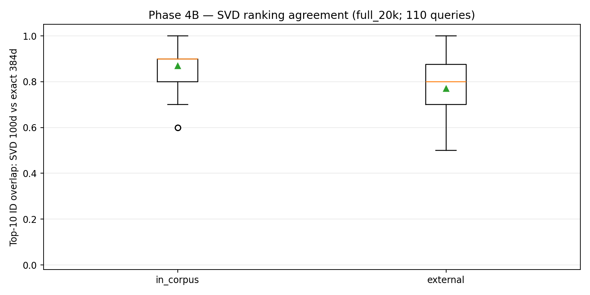
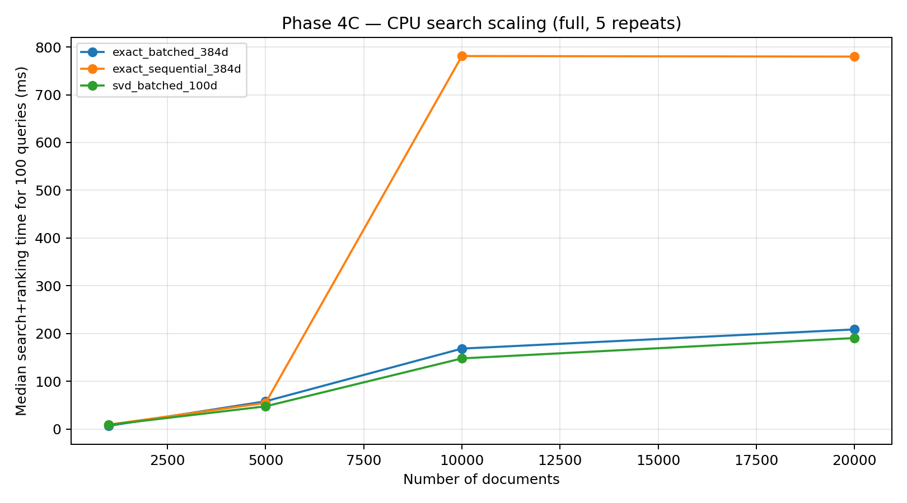

# Phase 4 — Final system, correctness, scaling and live demo

## System and reproducibility
- Real corpus: 20,000 Qwen-generated responses; cached 384-dimensional MiniLM embeddings.
- Search pipeline: input text -> MiniLM 384d -> saved TruncatedSVD k=100 -> normalized 100d index -> cosine scores (BLAS) -> stable Top-10.
- Source notebooks: [4A pipeline](../notebooks/14_phase4a_final_pipeline.ipynb), [4B correctness](../notebooks/15_phase4b_correctness.ipynb), [4C scaling](../notebooks/16_phase4c_scaling.ipynb), [4D live demo](../notebooks/17_phase4d_live_demo.ipynb).
- Full run files are in [benchmarks](../benchmarks) and [figures](../figures); model weights and full corpus are cached on Drive, not committed as large binaries.

## 4B: Correctness
20,000 documents, 100 in-corpus and 10 external text queries. Float32 BLAS exact 384d results were compared to float64 reference with score tolerance 1e-5.

| Query type | Number | Maximum absolute score error | Score tolerance pass | Exact Top-10 set match | Exact Top-10 order match | Mean SVD k100 Top-10 overlap |
|---|---:|---:|---:|---:|---:|---:|
| In-corpus | 100 | 1.46344e-7 | 100% | 100% | 100% | 86.9% |
| External | 10 | 1.26517e-7 | 100% | 100% | 100% | 77.0% |

No discrepancies recorded in the [discrepancy CSV](../benchmarks/phase4b_exact_ranking_discrepancies_full_20k.csv). SVD overlap is agreement with original cosine ranking, **not** relevance accuracy. In-corpus self-matches can raise measured overlap.

*Conclusion:* Exact float32 BLAS preserves the reference Top-10 under the tested conditions; reducing 384d to 100d loses some Top-10 agreement, particularly for external queries.

Evidence: [raw](../benchmarks/phase4b_correctness_raw_full_20k.csv), [summary](../benchmarks/phase4b_correctness_summary_full_20k.csv), [plot](../figures/phase4b_svd_top10_overlap_full_20k.png).

## 4C: Search scaling
CPU-only; 1 BLAS thread; 100 fixed in-corpus embedding queries; 2 warmups; 5 timed repetitions per configuration. **Measured times include similarity calculation and Top-10 ranking for all 100 queries, not encoding or model fitting.** Medians:

| Documents | Exact sequential 384d (ms) | Exact batched 384d (ms) | SVD batched 100d (ms) |
|---:|---:|---:|---:|
| 1,000 | 9.479 | 6.932 | 8.969 |
| 5,000 | 55.020 | 58.382 | 47.852 |
| 10,000 | 780.963 | 168.667 | 148.151 |
| 20,000 | 779.859 | 208.815 | 190.792 |

At 20K, exact batched BLAS is 3.73x faster than exact sequential BLAS; SVD batched is 4.09x faster than exact sequential, but only 1.09x faster than exact batched. **Thus batching is the larger observed performance improvement; SVD provides additional index memory savings and a modest incremental speedup, with a Top-10 quality tradeoff.**

*Conclusion:* Growth is not consistently linear over 1K–20K. Sequential timings jump at 10K and show substantial variability; do not claim the precise root cause without targeted profiling. BLAS, cache, memory access, ranking and Colab scheduling are possible contributors.

The 20K float32 index requires about 29.3 MiB at 384d versus 7.6 MiB at 100d, excluding other process and model memory. At 10x corpus size (200K), 384d raw vectors alone would occupy approximately 293 MiB. **200K performance has not been measured.**

Evidence: [raw 60 timings](../benchmarks/phase4c_scaling_raw_full.csv), [summary](../benchmarks/phase4c_scaling_summary_full.csv), [environment](../benchmarks/phase4c_environment_full.json), [plot](../figures/phase4c_scaling_full.png).

## 4D: Live interactive demo
The user ran the [Colab demo](../notebooks/17_phase4d_live_demo.ipynb) and entered `How can AI help detect cyber attacks?`. The real Top-10 document results appeared, with similarity scores and latency breakdown.

**One observed demonstration, not a repeated benchmark:** 69.91 ms total = 38.26 ms MiniLM encoding + 1.25 ms SVD transform + 30.40 ms vector search and Top-10 ranking. First hit was document 10832, cosine 0.7275. This single-query end-to-end number **must not be directly compared** with the 100-query batch timings in 4C.

For the required 30-second live demo, open Colab and preload the corpus/model/index **before** presenting; during the demonstration, type a new query and click Search. The result is computed live, not prerecorded.

## Design decisions and limitations
- Use batched BLAS for high-throughput exact searches; prefer 384d when original ranking fidelity is essential.
- Use k100 SVD for a memory-saving, faster approximate alternative; disclose its measured 77% external Top-10 overlap.
- Phase 1 TF-IDF Python timing is a different representation and cannot support a fair direct speedup against MiniLM; Phase 3D compares the same MiniLM vectors.
- No ground-truth human relevance labels; no GPU or distributed benchmark; no 200K measurement; single demo timing not representative of median latency.
- Presentation must explain each displayed plot and every code snippet; end with surprising findings and future work.
